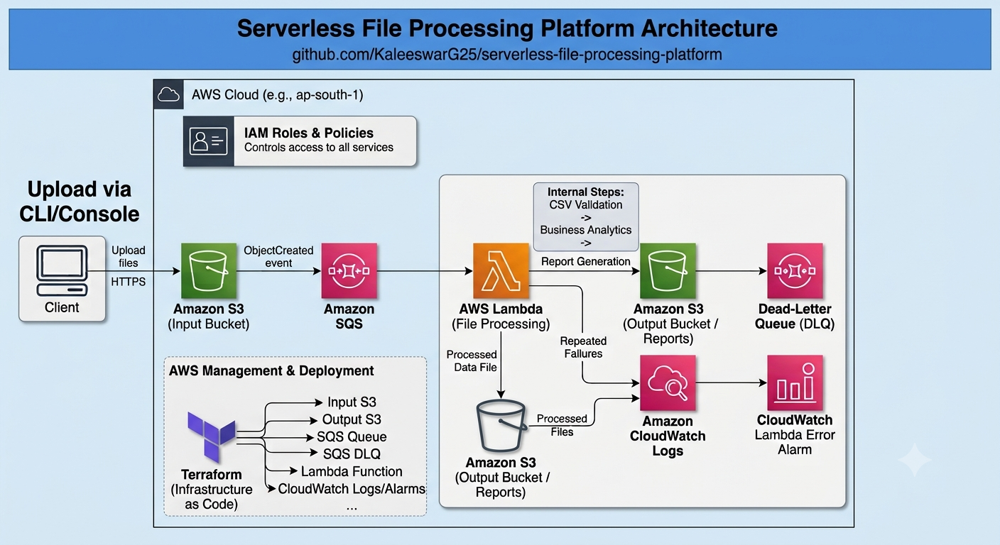
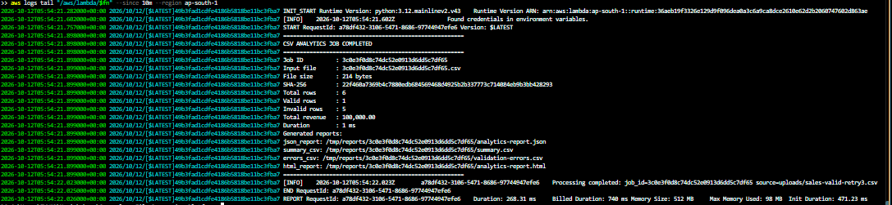
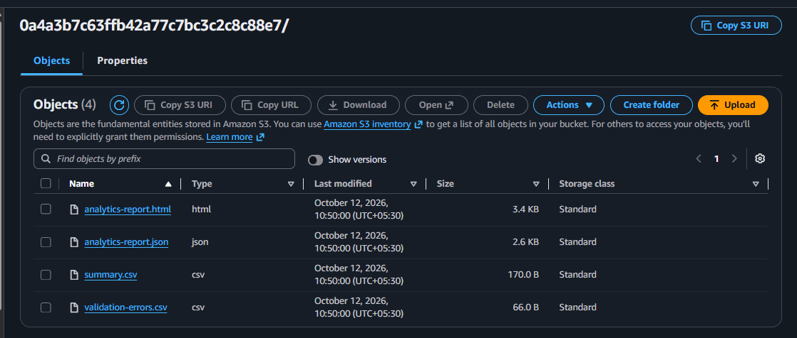

# Serverless File Processing Platform

An event-driven AWS serverless data processing platform that validates uploaded CSV files, calculates business analytics, and generates structured reports using AWS Lambda, Amazon S3, Amazon SQS, Python, and Terraform.

## Overview

The platform automates CSV processing without requiring a continuously running server.

When a CSV file is uploaded to Amazon S3, an event notification sends a message to Amazon SQS. AWS Lambda consumes the message, downloads and validates the file, calculates analytics, generates reports, and stores the resulting artifacts in S3.

The infrastructure is provisioned using Terraform.

## Architecture



### Processing workflow

1. Upload a CSV file to the `uploads/` prefix in the S3 bucket.
2. S3 publishes an object-created event to the SQS processing queue.
3. Lambda receives the queued event and retrieves the uploaded file.
4. The application validates the CSV structure and row data.
5. Valid records are used to calculate business metrics.
6. The application generates JSON, CSV, and HTML report artifacts.
7. The reports are uploaded under a unique job directory in S3.
8. Failed processing attempts can be retried, with repeatedly failing messages routed to the dead-letter queue according to the configured SQS policy.
9. CloudWatch collects Lambda execution logs and monitors Lambda errors.

## Technology Stack

| Technology | Purpose |
|---|---|
| Python 3.12 | Processing and analytics logic |
| AWS Lambda | Serverless execution |
| Amazon S3 | Input files and report storage |
| Amazon SQS | Asynchronous event processing |
| SQS dead-letter queue | Failed-message handling |
| Terraform | Infrastructure as Code |
| AWS IAM | Service permissions |
| Amazon CloudWatch | Execution logs and error alarm |
| pytest | Automated application tests |
| Git and GitHub | Version control and collaboration |

## Key Features

- Event-driven CSV processing.
- CSV schema and data validation.
- Business metrics and revenue calculations.
- Unique job identifiers for organizing output artifacts.
- JSON analytics reports.
- CSV summaries and validation-error reports.
- HTML reports for human-readable results.
- Asynchronous processing using SQS.
- Dead-letter queue configuration for repeated failures.
- Infrastructure provisioning using Terraform.
- S3 public-access blocking, server-side encryption, and versioning.
- HTTPS-only bucket access enforced through bucket policy.
- CloudWatch logging and Lambda error alarm.
- Automated unit tests for analytics, validation, and report generation.

## Repository Structure

```text
serverless-file-processing-platform/
├── docs/
│   ├── architecture.png
│   ├── lamda_logs.png
│   └── s3_report.png
├── src/
│   └── handler.py
├── tests/
│   ├── test_analytics.py
│   ├── test_report_builder.py
│   └── test_validator.py
├── sample-data/
│   └── sales-valid.csv
├── terraform/
│   ├── main.tf
│   ├── variables.tf
│   ├── outputs.tf
│   ├── versions.tf
│   └── .terraform.lock.hcl
├── requirements-dev.txt
├── .gitignore
└── README.md
```

The Terraform directory contains the infrastructure definitions. The application source and tests are maintained separately from the infrastructure configuration.

Generated Terraform state, provider caches, and Lambda deployment ZIP files should not be committed to Git.

## Prerequisites

Install and configure:

- Python 3.12 or a compatible local Python environment.
- AWS CLI v2.
- Terraform.
- Git.
- An AWS account with permission to provision the required services.

Configure AWS credentials using an appropriate AWS CLI profile or another supported credential mechanism.

Verify the configuration:

```powershell
aws sts get-caller-identity
aws configure list
terraform version
python --version
```

Use the AWS region configured in Terraform. The example deployment uses `ap-south-1`.

## 1. Clone the Repository

```powershell
git clone https://github.com/KaleeswarG25/serverless-file-processing-platform.git

cd serverless-file-processing-platform
```

If the repository has not been renamed, replace the URL with its current GitHub URL.

## 2. Run Automated Tests

Create and activate a virtual environment:

```powershell
python -m venv .venv
.\.venv\Scripts\Activate.ps1
```

Install the development dependencies:

```powershell
python -m pip install -r requirements-dev.txt
```

Run the test suite:

```powershell
python -m pytest -v
```

The application test suite covers CSV validation, analytics calculations, and report generation.

## 3. Configure Terraform

Navigate to the infrastructure directory:

```powershell
cd terraform
```

Review the configuration in `variables.tf` and adjust the project name, environment, region, unique resource-name suffix, and other parameters when required.

Validate the Terraform configuration:

```powershell
terraform init
terraform fmt -check
terraform validate
terraform plan
```

Review the proposed infrastructure changes before proceeding.

## 4. Provision AWS Infrastructure

From the repository root, run:

```powershell
terraform -chdir=terraform apply
```

Review the plan and confirm the apply operation.

Terraform provisions the resources defined in the configuration, including:

- S3 bucket for input files and reports.
- SQS processing queue and dead-letter queue.
- Lambda execution role and permissions.
- Lambda processor and SQS event-source mapping.
- S3 event notification and queue policy.
- CloudWatch log group and Lambda error alarm.

Retrieve the deployed resource names:

```powershell
$bucket = terraform -chdir=terraform output -raw bucket_name
$queue = terraform -chdir=terraform output -raw queue_url
$dlq = terraform -chdir=terraform output -raw dlq_url
$fn = terraform -chdir=terraform output -raw lambda_function_name

$region = terraform -chdir=terraform output -raw aws_region
```

## 5. Upload a CSV File

From the repository root, upload the sample CSV file:

```powershell
aws s3 cp sample-data/sales-valid.csv "s3://$bucket/uploads/sales-valid-demo.csv" --region $region
```

Uploading the file triggers the configured S3-to-SQS-to-Lambda processing workflow.

Use a different filename for each test upload to avoid confusion when inspecting results.

## 6. Inspect Generated Reports

List the report artifacts:

```powershell
aws s3 ls "s3://$bucket/reports/" --recursive --region $region
```

A successful processing job generates these artifacts beneath its job-specific directory:

```text
reports/<job-id>/
├── analytics-report.json
├── analytics-report.html
├── summary.csv
└── validation-errors.csv
```

The JSON report contains the structured job results and artifact locations. The HTML report provides a readable summary, while the CSV files contain metrics and validation details.

Download the reports locally:

```powershell
New-Item -ItemType Directory -Force -Path .\downloaded-reports

aws s3 cp "s3://$bucket/reports/" .\downloaded-reports\ `
    --recursive `
    --region $region
```

Inspect the downloaded HTML report in a browser or open the JSON and CSV files in an editor.

## 7. Inspect Lambda Logs

Read recent Lambda execution logs:

```powershell
aws logs tail "/aws/lambda/$fn" `
    --since 15m `
    --region $region
```

Look for the job identifier, processing status, row counts, calculated metrics, and report artifact paths.

## 8. Inspect SQS Queue Depth

Check the processing queue:

```powershell
aws sqs get-queue-attributes `
    --queue-url $queue `
    --attribute-names ApproximateNumberOfMessages ApproximateNumberOfMessagesNotVisible `
    --region $region
```

Check the dead-letter queue:

```powershell
aws sqs get-queue-attributes `
    --queue-url $dlq `
    --attribute-names ApproximateNumberOfMessages ApproximateNumberOfMessagesNotVisible `
    --region $region
```

SQS message counts are approximate. A message that is currently being processed may appear as not visible.

## 9. Verify Lambda Deployment

Inspect the deployed function configuration:

```powershell
aws lambda get-function-configuration `
    --function-name $fn `
    --region $region
```

Inspect the SQS event-source mapping:

```powershell
aws lambda list-event-source-mappings `
    --function-name $fn `
    --region $region
```

Verify that the mapping is enabled and check its state and any reported failure information.

## 10. Troubleshooting

### No reports appear in S3

1. Confirm that the uploaded object exists under `uploads/`.
2. Check whether the SQS processing queue contains messages.
3. Inspect the Lambda event-source mapping.
4. Read the Lambda CloudWatch logs.
5. Verify that the Lambda execution role can read uploaded files and write report artifacts.

### Lambda reports an AccessDenied or 403 error

Review the execution role's IAM permissions and any applicable bucket policies. Check whether the denied action targets an uploaded object or an existing report.

For example, checking an existing report using `HeadObject` requires suitable object-read authorization. Do not solve this by granting unrestricted S3 access.

### Messages repeatedly fail

Inspect the Lambda logs and the dead-letter queue. Correct the underlying processing or permissions error before attempting redrive.

### Terraform reports unexpected changes

Run:

```powershell
terraform -chdir=terraform fmt -check
terraform -chdir=terraform validate
terraform -chdir=terraform plan
```

Review the planned changes carefully. Do not delete Terraform state or manually recreate deployed resources to resolve a configuration error.

## Security Considerations

- Keep S3 public access blocked.
- Use encrypted S3 object storage and SQS queues.
- Restrict IAM permissions to the resources and actions the application needs.
- Enforce TLS for S3 requests.
- Keep AWS credentials out of source code and Git history.
- Do not commit Terraform state files, state backups, or deployment archives.
- Protect production state using an appropriate remote backend and state-access controls.
- Review CloudWatch log retention and alarm behavior.
- Configure suitable file-size limits and validate untrusted CSV input.
- Review AWS service quotas and costs before processing large volumes.

## Cost Considerations

This project uses managed AWS services that can incur charges, including Lambda invocations, S3 storage and requests, SQS requests, and CloudWatch logs and alarms.

Costs depend on usage, resource configuration, and the AWS pricing applicable to your account and region.

Destroy temporary infrastructure when it is no longer required.

## Cleanup

**Warning:** The following operation destroys Terraform-managed infrastructure and can permanently remove stored project data. Download any reports you want to retain before continuing.

From the repository root:

```powershell
terraform -chdir=terraform plan -destroy
terraform -chdir=terraform destroy
```

Review the destroy plan and confirm the operation only when you are ready to remove the environment.

Verify the resources in AWS afterward. Objects in an S3 bucket may affect deletion depending on bucket contents and the configured destruction behavior.

## Future Enhancements

Potential extensions include:

- Separate development, staging, and production environments.
- Additional CSV schemas and configurable validation rules.
- Processing status notifications.
- Larger-file handling and performance testing.
- Improved report retention and lifecycle policies.
- Integration and failure-recovery tests.

## Project Status

The project has been deployed to AWS and a sample CSV upload has successfully produced report artifacts in S3.

## Lamda Logs



## S3 Reports



## Author

**Eswar**

GitHub: [KaleeswarG25](https://github.com/KaleeswarG25)

Repository: [Serverless File Processing Platform](https://github.com/KaleeswarG25/serverless-file-processing-platform)
